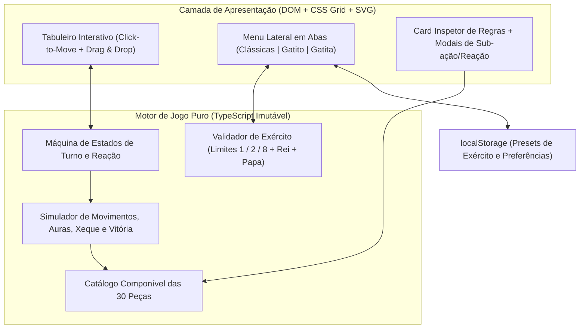

# Plano de Arquitetura e Especificação — Xadrex 2 (Gatito vs. Gatita)

Especificação consolidada a partir de [README.md](file:///home/caio/Documentos/github/pages/xadrex-2/README.md) e das decisões tomadas na entrevista de alinhamento, pronta para implementação no repositório [pages](file:///home/caio/Documentos/github/pages).

---

## 1. Escopo, Plataforma e Fluxo de Jogo

- **Modo de Partida:** **Local no mesmo dispositivo (*Pass-and-Play*)** otimizado para **PC (apenas mouse)** e **Tablet (toque)**.
- **Fluxo Secreto de Montagem:**
  1. **Preparação Jogador 1:** Monta e posiciona livremente seu exército nas suas 2 fileiras iniciais (com opção de salvar/carregar *presets* favoritos no `localStorage`).
  2. **Cortina de Privacidade:** Tela intermediária escondendo o tabuleiro (*"Passe o tablet/mouse para o Jogador 2"*).
  3. **Preparação Jogador 2:** Monta seu exército às cegas nas suas 2 fileiras iniciais.
  4. **Revelação Simultânea & Partida:** Os dois exércitos se revelam e começa o jogo por turnos (com botão de *Revanche mantendo os exércitos* ao final).
- **Modos de Orientação na Tela (alternáveis a qualquer momento):**
  - *Modo PC (Fixo):* todas as peças em pé;
  - *Girar por Turno:* tabuleiro rotaciona suavemente para o jogador da vez;
  - *Modo Mesa / Tablet Frente a Frente:* peças do Jogador 2 invertidas em 180° para quem está sentado do outro lado da mesa.
- **Estilo Visual:** **Fantasia Fofa & Tática** — medalhões ilustrados em SVG exclusivo para cada uma das 30 peças, paleta personalizável por jogador (ex.: Creme/Azul vs. Rosa/Roxo-Noite), destaques claros de ação no tabuleiro e suporte para substituição futura por imagens próprias (`PNG`/`WebP`).

---

## 2. Arquitetura e Stack para o GitHub Pages

Como o repositório [pages](file:///home/caio/Documentos/github/pages) publica os arquivos estáticos diretamente da branch `main`, o código-fonte em **TypeScript + Vite** ficará isolado em `xadrex-2/_src/` compilando o bundle estático diretamente na raiz de `xadrex-2/` (`base: './'`), para que `https://caiotome.github.io/pages/xadrex-2/` funcione imediatamente após o `git push`.



> [!IMPORTANT]
> **Paradigma Híbrido (Composição + Estado Imutável):** Nenhuma peça herda de outra por classes rígidas. Cada peça é definida por componentes de capacidade (`locomotion`, `attackPattern`, `activeAbility`, `aura`, `triggers`, `tags`), e cada ação aplica uma transição pura `(state, action) => nextState`, permitindo simular Xeque/Afogamento sem efeitos colaterais e suportar *Desfazer jogada* opcional.

### Máquina de Estados de Turno
Para suportar peças de múltiplas escolhas e reações defensivas apenas com mouse/toque:
1. `IDLE` -> jogador seleciona uma peça sua (ou inspeciona qualquer peça).
2. `PIECE_SELECTED` -> exibe casas válidas separadas por cor:
   - **Azul:** mover;
   - **Vermelho:** capturar (ocupando casa ou tiro à distância);
   - **Roxo/Verde:** habilidade ativa (*Construtor*, *Mago*), escolha de rota em "L" (*Gatito Gasoso*) ou cura de *Sapo* (*Rainha*).
3. `SUB_STEP` -> passos extras quando necessário:
   - *Gatito Gasoso:* escolher qual das 2 curvas do "L" varrer com gás;
   - *Mago:* clicar na 1ª casa vizinha e depois na 2ª casa vizinha para trocar;
   - *Homem Bomba* / *Pimentinha:* botão rápido *"Explodir! 💥"* ou *"Apenas Parar ✓"* ao concluir o movimento;
   - *Peão Clássico na 8ª fileira:* escolha de promoção (*Rainha, Torre, Bispo, Cavalo*).
4. `REACTION_GUARD` -> se um ataque for capturar uma peça que tenha um **Guarda** aliado adjacente vivo, abre alerta para o defensor escolher se o Guarda troca de lugar e morre no lugar dela.
5. `TURN_END` -> atualiza durações de status (*Pimentinha*, *Pássaro Uratal*) e avalia Vitória / Xeque-Mate / Empate.

---

## 3. Regras Globais Fechadas

| Regra | Comportamento Definido |
| :--- | :--- |
| **Abas de Montagem** | Sempre livres: os dois jogadores têm acesso às 3 abas (**Clássicas**, **Gatito**, **Gatita**). |
| **Posicionamento Inicial** | Liberdade total nas suas **2 fileiras iniciais (16 casas)** para reordenar ou substituir peças. |
| **Limites de Cópias** | **1 Rei obrigatório**. Especiais padrão: **máx. 2**. Únicas (**máx. 1**): *Príncipe* e *Papa* (*Papa* proibido junto com *Rainha*). Enxames (**até 8**): *Baratinha*, *Bela Adormecida*, *Mirra* (e Peões clássicos até 8). |
| **Realeza e Xeque-Mate** | *Rei* e *Príncipe* têm tag `isRoyal`. Com ambos vivos, um pode ser capturado normalmente; quando restar **apenas 1 peça Real viva**, aplicam-se aviso obrigatório de **Xeque** e derrota por **Xeque-Mate**. |
| **Vitória Especial** | Se o **Boto Cor-de-Rosa** capturar a **Rainha** inimiga, a partida termina imediatamente com vitória do dono do Boto. |
| **Afogamento / Empate** | *Baratinhas* não geram ameaça; se o jogador da vez não estiver em xeque na sua última peça Real e não tiver movimentos válidos, a partida termina em **Empate**. |
| **Promoção** | Exclusiva do **Peão clássico** ao alcançar a última fileira. Peças especiais nunca promovem. |

---

## 4. Catálogo Completo das Peças Especiais (24 Criações)

### A. Aba Peças do Gatito (10)
1. **Boto Cor-de-Rosa** *(máx. 2)*: Anda e captura como Cavalo. Ao capturar a Rainha inimiga, vence o jogo imediatamente.
2. **Sniper** *(máx. 2)*: Anda para casas vazias como Bispo. Ao capturar na diagonal (1ª peça na linha de visão), destrói o alvo **sem sair da própria casa**.
3. **Homem Bomba** *(máx. 2)*: Anda e captura como Peão. Ao final do seu movimento, pode optar por explodir: sacrifica-se e destrói todas as peças (aliadas e inimigas, exceto *Baratinhas*) nas 8 casas adjacentes.
4. **Príncipe** *(máx. 1)*: Anda e captura como Rei. Conta como peça Real reserva (`isRoyal`).
5. **Arqueiro** *(máx. 2)*: Anda para casas vazias como Rei. Captura no padrão em "L" de Cavalo à distância, **sem sair da própria casa**.
6. **Baratinha** *(até 8)*: Anda para casas vazias como Rainha. Não captura, é totalmente imune a capturas/explosões/transformações e não gera ameaça/xeque.
7. **Construtor** *(máx. 2)*: Anda para casas vazias como Rei e não captura. Habilidade ativa: gasta o turno para transformar 1 Peão clássico aliado adjacente em **Torre**.
8. **Mago** *(máx. 2)*: Anda para casas vazias como Rei e não captura. Habilidade ativa: gasta o turno escolhendo 2 casas dentre as 8 vizinhas ao Mago (2 peças aliadas/inimigas, ou 1 peça + 1 casa vazia) e troca o conteúdo delas.
9. **Papa** *(máx. 1, substitui Rainha)*: Anda e captura apenas como Rei. Enquanto estiver vivo, concede a todos os **Bispos aliados** movimento e captura adicionais de Rei.
10. **Guarda** *(máx. 2)*: Anda e captura como Peão. Reação defensiva: quando um aliado adjacente vai ser capturado, o Guarda pode trocar de posição com ele e morrer em seu lugar.

### B. Aba Peças da Gatita (14)
1. **Baleia Cinzenta** *(máx. 2)*: Desliza ortogonalmente como Torre, podendo atravessar e capturar **até 2 peças inimigas** no mesmo trajeto retilíneo (bloqueada por aliados ou por uma 3ª peça).
2. **Baleia Assassina** *(máx. 2)*: Anda para casas vazias como Torre. Só captura a 1 casa de distância nas **3 posições à frente** (diagonal-esq, frente, diagonal-dir), ocupando a casa.
3. **Gatito Gasoso** *(máx. 2)*: Salta como Cavalo escolhendo qual das **2 curvas do "L"** percorrer; destrói todas as peças (aliadas e inimigas, exceto *Baratinhas*) nas 2 casas intermediárias da curva escolhida + casa final.
4. **Gatito Apaixonado** *(máx. 2)*: Anda e captura como Cavalo; além disso, pode saltar diretamente sobre a **Rainha inimiga** se ela estiver num raio de até 2 casas de distância (quadrado 5x5 ao redor dele) para capturá-la.
5. **Gatito Mahchia** *(máx. 2)*: Anda para casas vazias como Rainha. Ao atacar uma peça inimiga na linha de visão, **para 1 casa antes** (ou permanece onde está se já estiver adjacente) e transforma a vítima em **Sapo** na própria casa dela (exceto se for a última peça Real inimiga, contra a qual ameaça Xeque/captura normal).
6. **Sapo** *(estado de transformação / máx. 2 se equipado)*: Anda apenas 1 casa para frente (vazia) e não captura. Guarda memória da peça original (`originalType`): se uma **Rainha aliada** terminar o movimento adjacente a ele (ou ativar cura encostando nele), volta imediatamente à sua forma original.
7. **Pássaro Uratal** *(máx. 2)*: Anda para casas vazias como Bispo e não captura. Sempre que se move, ativa seu grito para o próximo turno do oponente: qualquer peça inimiga escolhida para agir só poderá ir para a(s) casa(s) legal(is) que maximizem a distância até aquele Pássaro.
8. **Bela Adormecida** *(até 8)*: Anda 1 casa para frente e captura 1 casa diretamente à frente.
9. **Perereca** *(máx. 2)*: Anda e captura como Rei; se houver um inimigo adjacente com a casa imediatamente atrás dele vazia (na mesma direção), pode saltar por cima dele para essa casa vazia sem capturá-lo.
10. **Goham** *(máx. 2)*: Anda como Peão (sem captura). Aura passiva: peças inimigas adjacentes ao Goham ficam distraídas — não podem se mover, usar habilidades nem atacar o Goham (precisando ser abatido à distância ou salvo por terceiros).
11. **Mirra** *(até 8)*: Mesma mecânica da *Bela Adormecida* (anda 1 casa para frente e captura 1 casa à frente), com identidade visual própria.
12. **Quero-quero** *(máx. 2)*: Anda 1 casa para frente (vazia). Captura dando um rasante de **1 a 4 casas em linha reta à frente** (exigindo caminho livre), ocupando a casa da vítima.
13. **Tartaruga Maligna** *(máx. 2)*: Anda 1 casa para frente (vazia). Ataca a peça inimiga imediatamente à frente sem sair do lugar, transformando-a em **Sapo**.
14. **Pimentinha** *(máx. 2)*: Anda e captura como Peão. Ao final do seu movimento, pode optar por explodir: sacrifica-se e congela por **1 rodada** todas as peças nas **3 casas à frente** (diagonal-esq, frente, diagonal-dir), impedindo-as de agir no próximo turno.

---

## 5. Estrutura de Arquivos Planejada

```text
pages/xadrex-2/
├── _src/                           # Código-fonte TypeScript + Vite
│   ├── core/
│   │   ├── types.ts                # Estado imutável, coordenadas, tags e ações
│   │   ├── catalog.ts              # Definições declarativas das 30 peças
│   │   ├── setupValidator.ts       # Regras da fase de montagem (1 / 2 / 8, Rei, Papa)
│   │   ├── moveGenerator.ts        # Gerador de movimentos, tiros, saltos, auras e Xeque
│   │   └── reducer.ts              # Máquina de estados de turno, explosões, sapo e Guarda
│   ├── ui/
│   │   ├── pieceArt.ts             # 30 ilustrações SVG exclusivas em estilo medalhão fofo
│   │   ├── SetupScreen.ts          # Tabuleiro + Menu em abas + Drag/Click + Presets
│   │   ├── CurtainScreen.ts        # Cortina secreta entre jogadores
│   │   ├── MatchScreen.ts          # Partida, sub-ações, reação do Guarda e orientações
│   │   └── PieceInspector.ts       # Card detalhado de regras ao clicar/segurar
│   ├── styles/
│   │   └── main.css                # Tema Fantasia Fofa & Tática responsivo PC/Tablet
│   ├── main.ts
│   ├── package.json
│   ├── tsconfig.json
│   └── vite.config.ts              # Build com base './' apontando para ../
├── index.html                      # Bundle estático pronto para o GitHub Pages
├── assets/                         # JS/CSS compilados pelo Vite
└── README.md                       # Documento original preservado
```

---

## 6. Etapas de Execução e Verificação

1. **Setup do Projeto Vite + TypeScript** em `xadrex-2/_src/` configurado para gerar os estáticos limpos em `xadrex-2/`.
2. **Implementação do Core Engine + Testes Unitários Automatizados** cobrindo todas as regras especiais (tiro sem mover, explosão, rastro do *Gatito Gasoso*, metamorfose e cura do *Sapo*, reação do *Guarda*, aura do *Papa* e *Goham*, grito do *Pássaro Uratal*, *Rei + Príncipe* e afogamento com *Baratinhas*).
3. **Criação da Arte Vetorial das 30 Peças** e **Interface Completa** (Fase de Montagem com abas, Cortina Secreta, Tabuleiro de Partida, Modais de Sub-ação e Inspetor de Peças).
4. **Build Estático e Validação** verificando caminhos relativos para publicação imediata no GitHub Pages.
